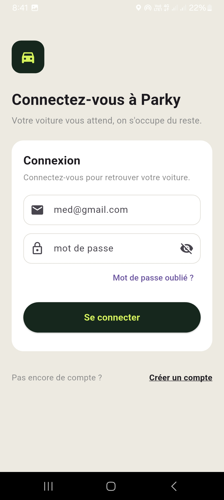
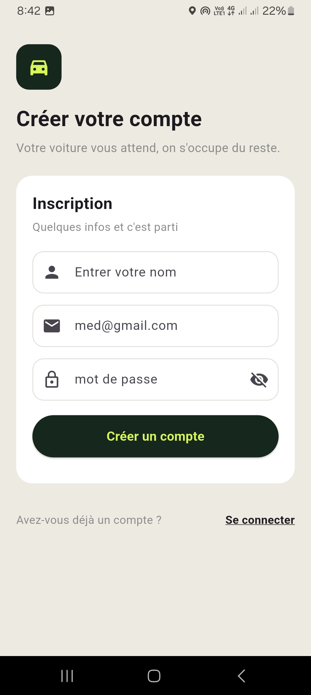
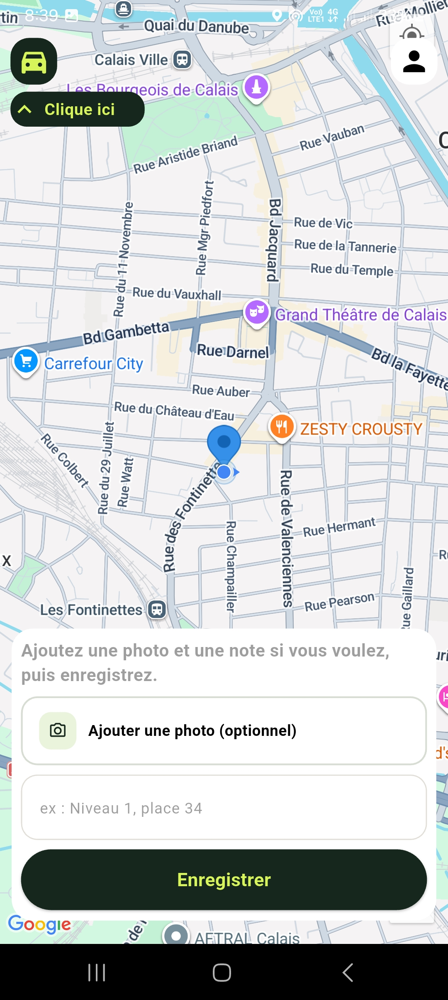
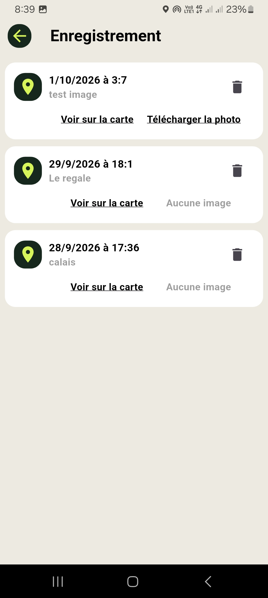
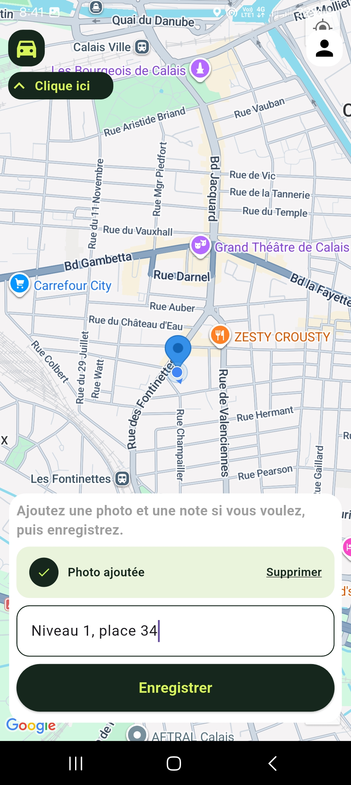
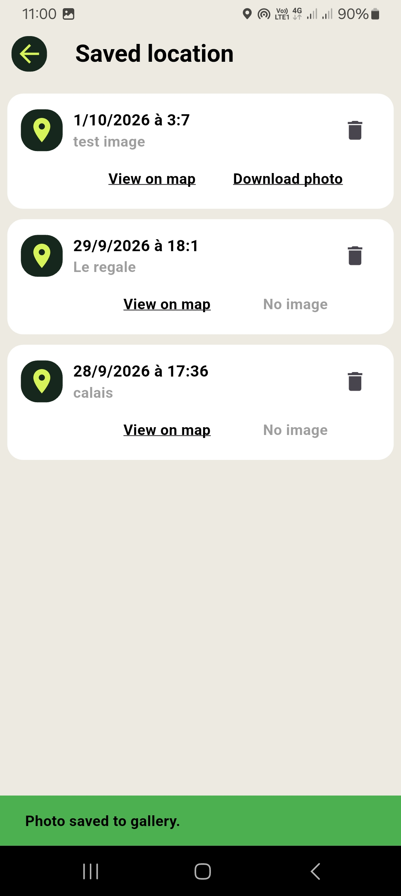
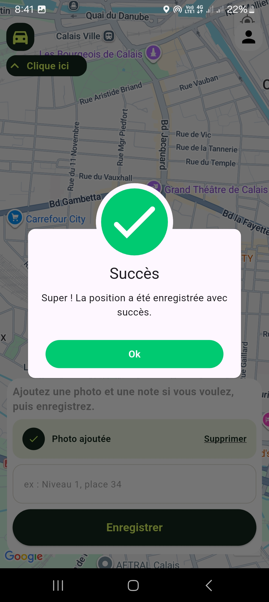
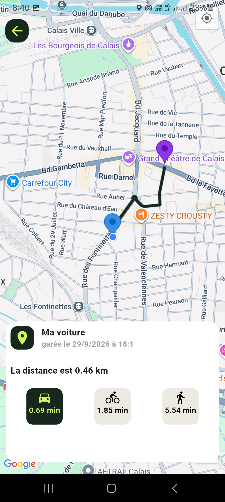
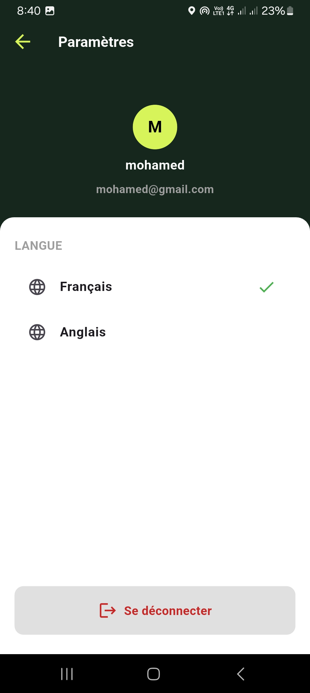

# Parky
 Application mobile Flutter permettant d'enregistrer l'emplacement d'un véhicule avec une photo afin de le retrouver facilement.

# ✨ Fonctionnalités
- Enregistrement de la position du véhicule
- Ajout d'une photo du véhicule
- Historique des stationnements
- Consultation des informations de chaque stationnement
- Retrouver rapidement son véhicule
- Gestion multilingue (Français et Anglais)
- Interface responsive adaptée à différents appareils

# Technologies utilisées
- Flutter
- Firebase Authentication
- Cloud Firestore
- Firebase Storage
- Provider
- Flutter Localization
- Git

# Captures d'écran

<table align="center">
  <tr>
    <td align="center">
      <b>Connexion</b> 
      
    </td>
    <td align="center">
      <b>Création de compte</b> 
      
    </td>
  </tr>
  <tr>
    <td align="center">
      <b>Accueil</b> 
      
    </td>
    <td align="center">
      <b>Enregistrement d'un stationnement</b> 
      
    </td>
  </tr>
  <tr>
    <td align="center">
      <b>Informations du stationnement</b> 
      
    </td>
    <td align="center">
      <b>Ajout d'une photo du véhicule</b> 
      
    </td>
  </tr>
  <tr>
    <td align="center">
      <b>Stationnement enregistré avec succès</b> 
      
    </td>
    <td align="center">
      <b>Localisation du véhicule</b> 
      
    </td>
  </tr>
  <tr>
    <td align="center">
      <b>Paramètres</b> 
      
    </td>
    <td></td>
  </tr>
</table>

# Auteur

- Mohamed ESSA

# Licence

Copyright © 2026 Mohamed ESSA

Tous droits réservés.

Ce projet est publié à des fins de démonstration et de portfolio uniquement.

Toute copie, modification, redistribution ou utilisation commerciale de ce projet sans autorisation écrite préalable de l'auteur est interdite.